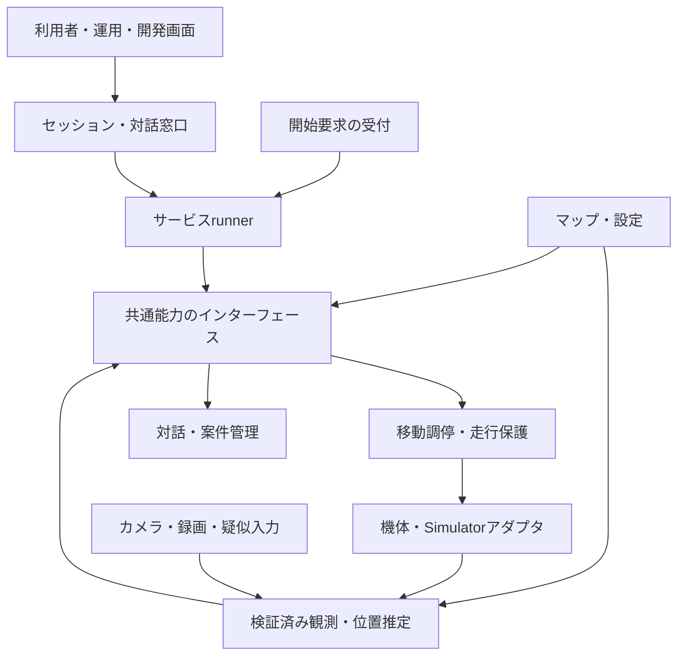
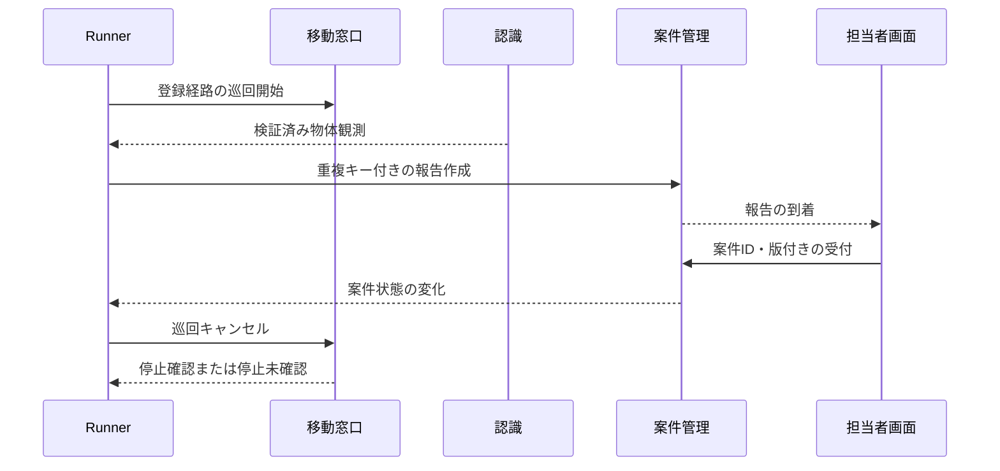

# 次期プラットフォーム：アーキテクチャ案

[English（正本）](architecture.md)

状態：設計たたき台、2026-11-05。[レビュー済み要求](requirements.ja.md)に基づく。
論理的な境界と初期配置の提案であり、実装済みの振る舞いではない。[現行アーキテクチャ](../architecture.md)と[基盤の状態](../platform-status.md)が現行版の説明である。製品選択は暫定とする。

## 1. 設計の基本方針

学生のサービス方針を、再利用可能な共通能力の上に置く。サービス実行をブラウザから分離し、既存のサーバ・機体側の走行保護を維持する。論理的な部品をすべて別サービスにせず、少数のプロセスと明確なインターフェースから始める。

初期の設計候補：

- TypeScriptのサービスrunnerを、まず独立したNode.jsプロセスで評価する。
- 既存Python Local Serverを基に、走行・保護を担当する独立プロセスを置く。
- 移動、観測、対話、案件、時計に共通の接続契約を設ける。
- 活動は並行しても、機体ごとの移動処理は一つだけとする。
- 構築済みLinux環境を準備し、WindowsではWSL2一式配布を評価する。
- ROS 2、LiDAR、実機なしでも使える軽量なシミュレーション経路を残す。

これらは設計仮説であり、移植性・遅延・配布を検証してから採用判断する。学生用mission/configの既存編集場所は当初維持する。パッケージ移動は、移行計画とリポジトリ指針の更新を伴って行う。

## 2. 論理構成

矢印は主な要求・データの流れであり、プロセス境界や全応答経路を表さない。対話窓口は画面の要求・回答をrunnerへ仲介する。運用者の停止には、サービスコードを介さず走行保護へ届く経路も設ける。観測には機体テレメトリと認識器の出力がある。

| 構成要素 | 担う責務 | 担わない責務 |
| --- | --- | --- |
| サービス定義 | 物品→行先の対応、順序、業務条件、復旧の選択 | 機体通信、操作権、保護限界 |
| runner・活動管理 | 実行ID、子活動の寿命、イベント処理、処理結果 | 物理的停止の保証 |
| 開始要求受付 | 手動・観測・タイマー起動、重複起動方針 | 障害後の暗黙的な再開 |
| 共通能力 | 経路走行、追従、観測取得、再利用できる対話 | 貸出・注文・清掃固有の方針 |
| 移動調停・走行保護 | 単一の移動所有者、制限、期限、走行許可、停止制約、接続先識別 | 業務判断 |
| 観測受付・位置推定 | 検証、鮮度、入力元・座標系の正規化、推定品質 | 清掃要否の判断 |
| 対話サービス | 構造化した質問、役割別配送、回答対応付け、入力検証 | 棚の選択や業務判断 |
| 案件サービス | ID、版付き状態、重複抑制、遷移の仕組み | 固定の業務状態機械 |
| 環境・試験サービス | マップ・設定の版、時計、リセット、入力シナリオ、記録 | 真値を通常の観測として無表示で渡すこと |

共通能力の契約は振る舞いを定義する。ROSのAction/Topicや箱庭PDUは接続の実装候補であり、その型を学生のサービス言語へ直接持ち込まない。

## 3. 主な接続契約

以下の名称は概念であり、確定したAPI宣言ではない。

| 契約 | 最低限の情報・意味 |
| --- | --- |
| 実行要求 | サービス・設定の版、接続先、起動ID、要求ID、必要能力 |
| 長時間処理 | runId、activityId、operationId、機体識別、受付／実行中／最終結果、失敗理由。中止受付と停止根拠を区別 |
| 観測 | 入力元、観測・受信時刻、時計の種類と試行世代、座標系、連番、有効性・品質、型付きデータ |
| 位置 | 連続したオドメトリ位置、マップ位置・座標変換、座標系・設定版、推定品質 |
| 質問・回答 | 質問ID、実行・活動、対象役割・セッション、入力形式、期限、回答ID。古い回答・別質問への回答を拒否 |
| 案件 | 案件ID、サービス定義のデータ・状態、版、冪等性キー。更新対象の版を検証 |
| 画像参照 | 撮影ID、入力元・時刻・座標系、アクセス制御された取得先。画像本体は通常のイベントキューに載せない |
| 能力一覧 | 対応操作・観測、座標系・時計、制限。開始受付前に整合確認 |

単位・軸は[既存プロトコル](../protocol.md)と整合させる。現行の便利APIには角度をdegreeで扱うものがあるため、移行時に明示変換し、同じ数値を黙って別単位として解釈しない。新しい内部契約はSI単位を基本とする。

### マップ・位置推定・移動

名前付き地点、登録経路、マーカー姿勢・実寸、必要な形状を、版付きの環境定義として共有する。Simulator固有の物理・描画アセットはそこから生成または関連付ける。同じ形状でも同じセンサー再現性を意味しない。

機体アダプタがオドメトリを供給し、位置推定が校正済みの既知マーカー観測からマップとオドメトリの対応を推定する。補正でローカルな距離移動・旋回の完了判定を飛ばさない。未知マーカーや不自然な補正を拒否し、不確かさ・観測喪失を示す。カメラ内部・外部校正は環境準備の責務とする。

経路能力はマップ位置と指定経路を用いる。初期は区間ごとの有界移動と経由点のフィードバックでよいが、時間指定の順列だけを地図ナビゲーションとは呼ばない。位置品質不足では停止を要求し理由を返す。登録経路だけで前方が空いているとは判断せず、現行のfresh CLEAR／監督下の走行許可を走行保護側で維持する。一般的な経路計画・障害物回避は含意しない。

実機走行中にマップ・設定の版を交換しない。停止・検証の後、新しい版で明示的に開始する。同じ版内の位置補正は通常の実行中処理として扱う。

## 4. 実行モデルとイベント規則

実行単位runが活動を所有し、子活動は親より長く生存しない。活動は処理完了を待ち、イベントを受け取れる。購読・タイマー・質問は活動終了時に解除する。通常の順次サービスは簡潔に保ち、必要な場面で並行処理を使う。

mailboxの初期案：

- 活動ごとの状態遷移は直列化する。遷移処理は非同期作業を開始して戻り、完了を対応付けたイベントで受け取る。長時間処理を遷移ハンドラ内で待ち続け、mailboxを塞がない。
- 観測の最新値バッファと、上限付きの業務イベントキューを分ける。最新観測は集約できるが、案件・回答イベントを黙って捨てない。
- 一つのキューでは受付順を守る。複数送信元をまたぐ全順序は保証しない。入力元の連番と実行・処理IDで古い結果を排除する。
- 再接続をまたぐ要求は重複し得る。冪等性キーと版確認で扱い、exactly-once配送を約束しない。
- キュー過負荷は拒否・送信抑制と可視のエラーで扱う。必要な制御進行が失われたら実行を中断する。停止は業務キューを迂回する。
- 手動・観測・周期タイマーは共通の開始受付を通す。初期はサービス・機体ごとに一つのrunとし、重複開始を明示して拒否する。配送サービス内で案件を待ち行列にできる。起動要求のキュー化・集約は後の選択肢。
- タイマーごとに時計を選ぶ。休止・再起動後の取り逃した周期は初期にはスキップし、大量の追いつき起動を行わない。

学生にはasyncのシーケンスを提供できるが、管理側は独立にキャンセルを処理する。学生コードがCPUを占有した場合、協調キャンセルだけでは止められない。そのため走行保護とプロセスを分け、runnerの健全性・処理進行が失われたら認可更新を止める。これは障害分離であり、悪意あるコードへの完全なサンドボックスではない。

### キャンセルと移動調停

通常の実行はcreated→running→completed／failed／cancelled／interruptedへ進む。キャンセル要求ではまずcancellingとし、子活動を中止し、待機中の移動要求を無効化し、動作中の制御器を止め、実時間の期限内に停止根拠を待つ。

停止を確認できなければstop-unconfirmedとし、新規走行を禁止して運用者の復旧を求める。キャンセル成功・到着成功を返さない。

追従と経路走行は機体ごとの単一移動トークンを共有する。旧制御器の停止・解放が完了してから次が取得する。競合要求は初期には拒否し、速度を混ぜない。運用者の操作引継ぎはサービスの移動活動を中止する。非常停止は操作権不要でrunnerを経由しない。

通常の移動指令・更新・キャンセル・停止は、run／operationと移動許可の世代に結び付ける。走行窓口は要求ごとに現在の所有者と世代を検証する。引継ぎでは旧世代を無効化してから次へ許可し、失効したrunには再取得も認めない。再開には新たに明示的な開始受付を通したrunを必要とする。旧活動の遅延した通常停止や後始末で、別の所有者の走行を止めない。

運用者の全体停止・非常停止は、サービスのトークンとは独立した全体停止権限で扱う。古いサービス要求を排除する規則によって、これらの停止を妨げない。

走行保護が最終的な認可主体となり、TTL・機体限界・走行許可・機体watchdogを維持する。プロセスのheartbeatだけで古い指令を生存させず、処理進行の期限と指令更新限界を定義する。

## 5. 対話・案件・保持状態

ブラウザのコールバックに結び付いた質問を、対話インターフェースへ移す。画面は質問を表示し、ID付き回答を返す。次の業務動作はサービスが決める。

すべての質問で全活動を停止する設計にはしない。受け渡し確認は機体停止を必要とする一方、新規注文受付は別案件の配送と並行し得る。対話能力の呼出しでこの違いを明示する。

積載・受領など静止を必要とする対話では、動作中の走行を停止した上で、質問を表示する前に機体全体の走行禁止ガードを取得する。人が作業している間はガードを保持し、別活動・別runの移動も禁止する。通常の新規注文入力はこのガードを取得しない。

ガードの解除には、設定した「人の作業が終わり走行可能」という確認を必要とする。質問のキャンセル、画面切断、タイムアウトだけでは作業終了と判断しない。確認できなければ走行禁止を保持し、運用者による明示的な復旧を待つ。全体停止・非常停止は常に利用できる。ガードを移動トークンの状態にするか、別のインターロックにするかは実装時に決める。

本・物品・注文から行先や到着案内への対応表はサービスが持つ。対象なし、支援辞退、未対応の行先は業務上の分岐とする。拠点への帰還も認可された移動であり、障害状態を迂回しない。

案件には、版・冪等性記録を保持する小さなローカル永続ストアを接続する案とする。SQLiteは候補であり必須ではない。画像は別保存し、アクセス・保持期間を設定して撮影IDで関連付ける。最初の試作はメモリ保存でもよいが、再起動による消失を明示し、永続的な受付完了を主張しない。担当者の完了登録シナリオを受け入れる前に永続化範囲を選ぶ。

runの状態と案件状態は分ける。プロセス再起動後の旧runは中断扱いで、自動走行再開しない。保持した案件は担当者が参照し、運用者が明示的に復旧を選ぶ。通知送信・表示成功・人の受付・対応完了を区別する。再接続では現状態を取得し、行動を再実行しない。

## 6. 初期の実行配置

| 配置先 | 内容の案 | 補足 |
| --- | --- | --- |
| 学生のブラウザ・スマホ | サービス／運用／開発画面。任意のカメラ・音声入力 | モーター認可や唯一のrun状態を持たない |
| 準備済みLinuxホスト | TS runner、Python走行保護・サーバ、能力モジュール、案件・画像保存 | 最初は1ホスト。runnerと走行保護は別プロセス |
| シミュレーション実行先 | 軽量Simulator、またはMuJoCo・Godot接続 | 初期は同じLinuxホスト。WindowsではWSL2/WSLgを評価 |
| 実機 | アダプタ接続先、ファームウェアの制御・watchdog | チーム計算機／機体搭載の配置は測定で決める |

画面の窓口は当初Pythonサーバに残し、認証したローカル接続でrunnerと連携できる。初期から汎用メッセージブローカは要求しない。ROS追加時も競合する二つ目の走行認可主体を作らない。

実機試験には、利用者画面とは別の運用セッション・期限付き操作許可を提案する。通常の担当者画面が切断しただけで無関係な案件を終了させる必要はない。一方、運用許可の失効、必須のスマホ認識喪失、runner接続断、機体通信断では該当走行を停止・中断する。再接続後は明示的な復旧・開始を必要とする。

これは現行のブラウザ所有契約を変更する設計であり、専用の移行試験が必要。無人運用の許可ではない。

配布環境に版固定の実行物・モデル・起動・診断を含める。学生の作業は交換可能な環境イメージとは独立してバックアップ・出力できるようにする。WSL取り込みだけでWindows側のドライバや仮想化設定は配布できない。スマホHTTPS、LAN接続、オフラインでのモデル利用、GPU描画は新規PCで確認する。ARM計算機には構築手順を共有し、x86のWSLイメージを流用しない。認証情報をイメージへ埋め込まない。

## 7. シミュレーションと技術の可変点

時計と試験制御は機体制御と別のインターフェースにする。リセットはrunをキャンセルし、活動キュー・質問を解放して試行世代を更新し、初期状態を読み込む。旧世代の遅延メッセージは新しい試行へ作用しない。試験操作で実機を暗黙に選択・リセットしない。

シミュレーション時刻は仮想走行・missionのタイマーに使う。ホストの健全性、停止確認期限、実機watchdogは実時間の単調時計を使う。再生はシミュレーションへ観測を注入し、過去の走行指令を実機へ再送しない。

pauseは進行障害とは別の明示的なSimulator状態とする。休止が確認されている間、仮想処理の進行期限と仮想観測の鮮度は休止したシミュレーション時計に従い、仮想的な進行がないことをrunner障害としない。ホストの健全性、制御経路の疎通、実機watchdogは実時間で監視し続ける。休止中でもホスト・制御接続の喪失は障害である。

Simulatorの制御経路は、物理ステップを待たずにcancel／resetを処理できるようにする。未実行の駆動を無効化し、取り消した仮想処理が再開しないことを確認する。これは仮想的な停止根拠であり、実機の静止根拠とは区別する。resetはキャンセル・無効化を完了してから新しい試行世代へ移る。制御経路が応答しなければ、休止中でも実時間の停止確認期限で失敗とする。休止解除でキャンセル済み処理を復活させず、pauseによって実機watchdogや運用者の許可期限を停止しない。

| 可変点 | 最初の評価候補 | 判断基準 |
| --- | --- | --- |
| サービス実行 | Node.js＋既存TSの入口 | ブラウザ依存を外せるか、キャンセル・診断の扱いやすさ |
| ロボティクス基盤 | 既存サーバ・能力モジュール、任意のROS 2接続 | 部品再利用の利点と統合・配布費用 |
| リッチなSimulator | MuJoCo物理＋Godot表示、直接接続または箱庭経由 | 画像・制御接続、時間の意味、導入、反復性 |
| 認識 | 既存スマホ経路＋差し替え可能な物体認識器 | 対象、遅延、入力喪失、計算配置 |
| 配布 | 構築済みWSL2/Linux、チーム計算機1台の試作 | 初見の導入・復旧、GPU/LAN、費用 |
| 案件保存 | 初期試作はメモリ、復旧試験では永続アダプタ | 受付の永続性と保持期間 |

MuJoCoとGodotを使う場合、物体ごとの物理状態の決定主体を一つにし、同じ機体を両者で独立に動かさない。描画形状・衝突形状・撮影画像の対応を定義する。Godotで表示できるだけではカメラ→認識経路の成立を意味しない。

箱庭はシミュレーション接続・時刻の内側、ROS 2は選択したロボティクス能力・アダプタの内側に置く。両方・片方・どちらも使わない構成を比較できる。学生の業務イベントの意味はどちらにも委ねず、導入だけで決定的実行を保証したとは扱わない。ROS不要の軽量経路を維持する。

## 8. 代表シナリオの処理の流れ

### S1：巡回・検出・通知

場所は通知時ではなく観測時に対応付ける。一致する位置がなければ、部屋・巡回地点の不確かな文脈として明示する。清掃条件・重複判定方針はサービスが持ち、案件管理がキー・版の仕組みを提供する。通知失敗は送信待ち・失敗として残し、対応完了としない。

撮影に停止が必要なら巡回活動を中断し、停止確認後に撮影して、有効な位置・経路地点から明示的に継続する。この経路で安全停止から勝手に再開しない。

### S2：配送・受け渡し

構造化入力→サービス側の行先解決→案件作成→停止状態での積載確認→経路移動→到着・停止確認→受領確認→案件完了→任意の帰還。

到着は受領の代わりにならない。追加依頼は待機案件となり、競合する走行を始めない。確認が来なければ待機・タイムアウトを示し、サービスが人への依頼・中止を選ぶ。

### S3と追従・注文・配送

検証済み人観測から開始受付を通し、支援を断ることもできる。先導は経路移動と同行者確認を組み合わせる。同行者の喪失・遅れでは経路走行を止めて待機する。初期確認は入力でもよい。再開には有効なrun、位置、走行許可、選択した確認条件が必要。

追従型では対象喪失で停止する。到着確認では追従制御器を中止して終了を待ち、停止確認後に席を記録する。その後同じ対話・案件インターフェースで注文を受け、配送は新しい経路処理として取得する。未対応の行先・物品は走行障害と分けてスタッフへ案内できる。旧活動への遅延回答・追従結果で配送を開始しない。

## 9. 既存資産と移行

以下はソース・インターフェース確認に基づく再利用評価であり、移植・実機検証済みという意味ではない。

| 現行資産 | 扱いの案 | 確認する差分 |
| --- | --- | --- |
| studentService.ts／StudentServiceApi | 簡潔なシーケンスと選択肢検証を活かす | 質問・音声、待機タイマー、全体キャンセルのブラウザ依存 |
| missions/api.ts／MissionContext | 型付き観測、進捗、キャンセルを適合 | 実行・活動ID、時計注入、長時間処理ハンドル |
| 追従・マーカーmission部品 | 契約に合う動作を再利用 | 対象喪失、停止確認、経路走行と直接マーカー誘導の違い |
| Python Local Server／RoverAdapter | 最終走行保護・機体通信境界を維持 | runnerの識別・許可、移動トークンの寿命、停止根拠 |
| 認識・オドメトリ部品 | 観測検証とローカル座標分離を活かす | 一般物体、校正済み地図位置推定、品質契約 |
| Simulator／scenario／ログ | 高速試験と再生の分離を維持 | 時計・世代、共通マップ、リッチなセンサー接続 |
| 共通PWA | 画面の役割分離とサービス画面変更を維持 | 複数セッション・役割、質問回答の対応付け |

参照：[学生向けAPI](../../apps/pwa/src/service/studentService.ts)、[mission契約](../../apps/pwa/src/missions/api.ts)、[機体アダプタ](../../apps/server/src/apris_server/adapter.py)、[Mission API説明](../mission-api.md)。

現行の学生向けAPIは質問前とサービス終了時に対象範囲を限定しないstopを呼ぶ。並行runへ移す際、そのまま流用しない。通常の後始末は処理単位のキャンセルへ対応付け、静止対話のガードは必要な場面だけで取得する。例えば、移動していない質問活動をキャンセルしても、別runの配送を止めない。

現行の説明上、stopの完了は停止指令の送信であり、物理的な静止の証明ではない。アダプタの根拠なしにPromiseの完了を新しい停止確認へ読み替えない。現行の共通画面で実機マーカー誘導が未検証・無効である状態も、再利用だけでは変わらない。

移行順序：

1. 既存サービス一つを、明示したインターフェースと疑似バックエンドで包む。編集場所を維持する。
2. 対話・時計を注入してrunnerを分離し、ブラウザ喪失・プロセス障害を試す。
3. マップ・位置推定・経路と、S1の物体報告を追加する。
4. S2・S3の組合せ、仮想故障、監督付き実機を確認する。
5. 対応構成を配布して独立試用する。実装と根拠が揃ってから現行状態の正本を更新する。

## 10. 要求との対応と検証

| 要求 | 主な担当 | 初期検証 |
| --- | --- | --- |
| F01、F02 | 環境・位置推定 | マップ版・座標系、ドリフト・補正・外れ値 |
| F03、F14 | 経路／追従能力・移動窓口 | 巡回・帰還、追従→経路の切替、二重所有の防止 |
| F04 | 観測受付・入力提供者 | 疑似／録画／実入力の検証、鮮度喪失 |
| F05、F06、F13 | 活動管理・開始受付・移動窓口 | 重複起動、中止競合、遅延イベント、過負荷 |
| F07、F08 | 対話・案件・サービス方針 | 誤回答・古い回答、重複報告、受領待ち、再起動 |
| F09 | 能力一覧・アダプタ | 対応能力を明示したSimulatorと実機で同じサービス |
| F10 | 時計・試験制御 | 休止・リセット・世代、反復条件 |
| F11 | 記録・画面への状態反映 | run・処理・観測を対応付けた待機／停止理由 |
| F12 | 将来の経路計画・センサー接続 | 後段。現在の計画・回避能力を主張しない |
| Q01、Q03 | 走行保護・許可・活動管理 | UI／runner／機体喪失。物理停止は別途検証 |
| Q02、Q05、Q07 | 配布・復旧 | 新規PC、オフライン、学生作業の復元 |
| Q04、Q06 | 接続契約・能力一覧・出自情報 | バックエンド交換、真値／推定／入力元の表示 |
| Q08 | 時刻付き診断・能力設定 | 遅延・精度・資源・停止の基準を測定 |
| Q09 | アクセス・案件画像保持・秘匿化 | 役割別アクセスと診断の認証情報除去 |

実機試験・Simulator受入前に、次の契約も確認する。

- 引継ぎ後まで旧runの移動・更新・通常停止を遅延させ、旧世代の作用を拒否しつつ全体停止が有効なこと。
- 積載・受領中に別runの移動を試し、質問中止・タイムアウト・画面切断でも走行禁止を保持し、作業終了確認でのみ解除できること。
- 経路実行中に休止し、物理ステップなしでcancel／resetすること。誤った進行タイムアウトを起こさず、ホスト喪失は検知し、試行世代を分離し、休止解除で取り消した指令を復活させないこと。

実装前に詰める事項：アダプタごとの停止確認根拠、運用者・runnerの許可期限、画像と位置の時刻対応、キュー上限、永続化範囲、最低限のPC/GPU、サービスの実行物への組込み、ROS／箱庭の採否。

採用する判断は小実験の後に個別ADRへ記録する。本書は実行コード、現行能力の主張、実機検証状態を変更しない。
