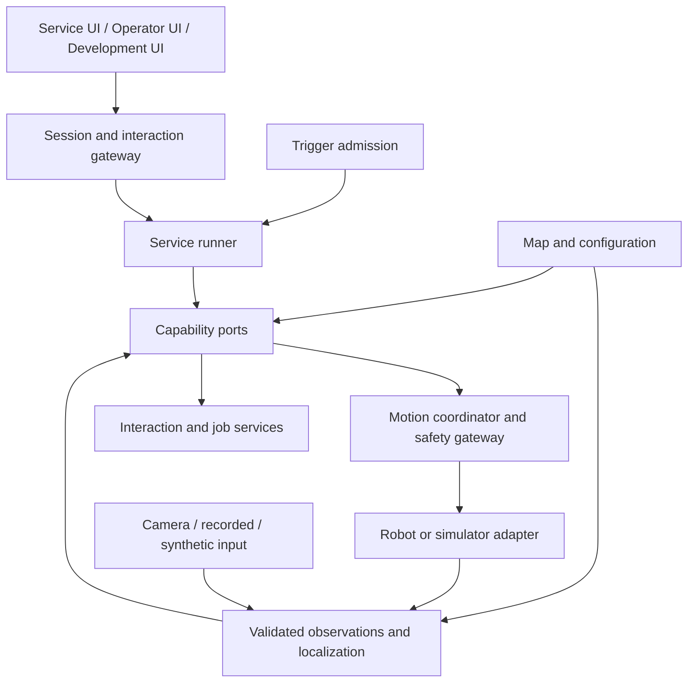
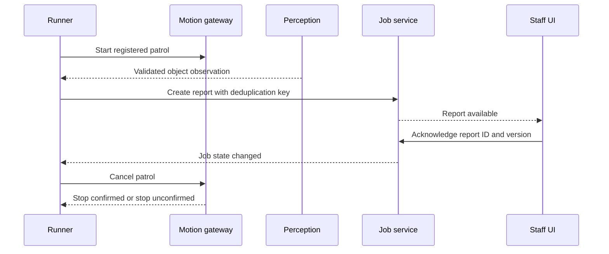

# Next platform: architecture proposal

[日本語](architecture.ja.md)

Status: design draft, 2026-11-05. Based on the reviewed [requirements](requirements.md).
This proposes logical boundaries and a first deployment, not implemented behavior.
The [current architecture](../architecture.md) and [platform status](../platform-status.md)
continue to describe the shipped system. Product choices remain provisional.

## 1. Architectural approach

Keep participant service policy above reusable capabilities. Move service execution
out of the browser, while retaining the existing server/device motion protections.
Start with a few processes and modules with explicit ports; do not turn every logical
component into a separate service.

Proposed initial choices:
- A TypeScript service runner, evaluated first in a separate Node.js process.
- An independent safety/motion process based on the existing Python Local Server.
- Capability contracts for movement, observations, interaction, jobs and clocks.
- One active motion operation per robot, even when several activities run concurrently.
- A prepared Linux runtime; evaluate a complete WSL2 distribution on Windows.
- Lightweight simulation remains available without ROS 2, LiDAR or a physical robot.

These are design hypotheses. Validate portability, latency and packaging before treating
them as adopted decisions. Preserve existing mission/config edit locations initially;
a package move requires an explicit migration and repository-guidance update.

## 2. Logical structure

Arrows show principal requests/data flow, not separate processes or every return channel.
The gateway routes UI requests to the runner and handles correlated responses; it also
exposes a direct operator stop path to the safety gateway, independent of service code.
Observation data comes from both robot telemetry and perception providers.

| Component | Owns | Does not own |
| --- | --- | --- |
| Service definition | Item-to-place mappings, sequence, business conditions, recovery choices | Motor transport, authorization or safety limits |
| Runner / activity supervisor | Run identity, child lifetimes, event dispatch, operation results | Physical stopping guarantees |
| Trigger admission | Manual/observation/timer start requests, overlap policy | Implicit mission resume after failure |
| Capability implementations | Route execution, following, observation access and reusable interaction | Domain-specific loan/order/cleaning policy |
| Motion coordinator / safety gateway | One motion owner, limits, expiry, clearance, stop interlocks, target identity | Service business decisions |
| Observation ingress / localization | Validation, freshness, source/frame normalization, pose quality | Deciding that an object requires cleaning |
| Interaction service | Structured prompts, role routing, correlation, answer validation | Selecting a shelf or interpreting a business policy |
| Job service | IDs, versioned records, deduplication and transition mechanism | Fixed domain state machines |
| Environment / trial services | Map/config versions, clock, reset, input scenarios, trace | Turning simulation truth into unlabelled sensor data |

Capability ports describe behavior, not a mandatory wire protocol. ROS actions/topics
or Hakoniwa PDUs may implement selected ports, but their types must not become the
student service language.

## 3. Principal contracts

Names below are conceptual, not final API declarations.

| Contract | Minimum information and semantics |
| --- | --- |
| Run request | Service/config version, target identity, trigger ID, request ID and required capabilities |
| Operation | runId, activityId, operationId, robot identity, accepted/running/final state, failure reason; cancel request and stop evidence are distinct |
| Observation | Source, observed/received timestamps, clock domain and epoch, frame, sequence, validity/quality and typed payload |
| Pose | Continuous odometry pose, map pose/transform, frame/config revision and quality; never an unlabeled mixture |
| Prompt / answer | Prompt ID, run/activity, intended role/session, schema, expiry, answer ID; stale or unrelated answers are rejected |
| Job | Job ID, service-defined payload/state, version and idempotency key; transitions validate expected version |
| Image reference | Capture ID, source/time/frame and controlled retrieval reference; binary images do not travel in the ordinary event queue |
| Capability manifest | Supported operations, observation types, frame/clock conventions and limits; validate before admitting a run |

Preserve the units/conventions in [the protocol](../protocol.md). Existing convenience
APIs use degrees for some angles; any migration must convert explicitly rather than
silently reinterpret numbers. Internal new contracts should use SI units.

### Map, localization and movement

Use one versioned environment definition for named places, registered routes,
marker poses/sizes and relevant geometry. Simulator-specific physics/visual assets
are generated or associated with it; identical geometry does not imply identical sensing.

Robot adapters supply odometry. Localization combines it with calibrated known-marker
observations to estimate map-to-odometry alignment. Corrections must not jump local
distance/turn completion. Reject unknown markers and implausible corrections; expose
uncertainty and source loss. Camera intrinsics/extrinsics belong to environment setup.

The route capability uses map pose and a declared route; the initial executor may use
bounded segments and waypoint feedback. A timed sequence alone is not map navigation.
Poor localization requests a stop and reports a reason. Registered paths do not prove
free space: current fresh-CLEAR/supervised-clearance rules remain in the safety gateway.
No general planner or obstacle avoidance is implied.

Map/config changes are not applied midway through a physical run: stop, validate and
explicitly start with the new revision. Localization corrections within that revision
are normal runtime behavior.

## 4. Execution model and event semantics

A run owns scoped activities. An activity can await operations and subscribe to events;
a child cannot outlive its parent. Subscription, timer and prompt cleanup is automatic.
Keep ordinary sequential services simple; expose concurrency only when needed.

Initial mailbox proposal:
- Serialize state transitions per activity. A transition starts asynchronous work and
  returns; completion arrives as a correlated event. Do not block a mailbox by awaiting
  a long operation inside its state-transition handler.
- Keep latest-value observation buffers separate from bounded business-event queues.
  Latest values may coalesce; job/answer events are not silently dropped.
- Preserve admission order within one queue; do not claim a total order across producers.
  Use source sequence numbers and operation/run identity to reject stale results.
- Requests crossing reconnects can repeat. Use idempotency keys and version checks;
  do not claim exactly-once delivery.
- Queue overflow rejects/backpressures the producer with a visible error. Loss of
  required control progress interrupts the run. Stop handling bypasses business queues.
- Manual, observation and interval triggers share admission. Initially allow one active
  run per configured service/robot and reject duplicate starts visibly. A delivery
  service can queue jobs within its run. Queue/coalesce policies are later alternatives.
- Choose a clock for each timer. Periodic triggers do not accumulate an unlimited
  catch-up burst after pause/restart; initial policy skips missed periods.

Student code may use async sequences through a facade, while the supervisor processes
cancellation independently. Arbitrary CPU-blocking student code cannot be reliably
cancelled cooperatively, so isolate it from the safety process and stop renewing its
authorization if runner health/progress fails. This is fault isolation, not a complete
sandbox for hostile code.

### Cancellation and motion arbitration

Normal lifecycle: created → running → completed/failed/cancelled/interrupted.
Cancellation first enters a cancelling state. Cancel scoped work, invalidate queued
motion requests, stop the active controller, and wait for stop evidence with a real-time
deadline. If stopping cannot be confirmed, report stop-unconfirmed, inhibit new motion
and require operator recovery; never report successful cancellation/arrival.

Following and route movement share one robot motion token. Switching requires the old
controller to stop and release before the new one acquires. Competing requests are
rejected initially, not blended. Operator takeover cancels the service's motion scope;
E-stop remains available without ownership and bypasses the runner.

Normal motion commands, renewals, cancellation and stop requests are scoped to a
run/operation and a generation of motion authorization. The motion gateway validates
the current owner and generation on every request. Revocation fences off the old
generation before granting another owner; requests from an invalidated run cannot
reacquire motion authorization without a new explicitly admitted run. A delayed
normal stop or cleanup from an old activity must not stop a different owner's motion.
Operator global stop and E-stop use separate global-stop authority, independent of
the service's token; stale service requests cannot suppress those stops.

The safety gateway remains the final authorizer. Preserve TTL, hardware limits,
clearance and device watchdogs. A process heartbeat alone must not keep an obsolete
command alive. Define operation-progress deadlines and bound command renewal.

## 5. Interaction, jobs and retained state

Move prompts away from browser callbacks into an interaction port. The UI renders a
prompt and sends a correlated answer; the service determines subsequent behavior.
New prompts need not always stop every activity: a handover prompt requires a stationary
robot, while new-order input may coexist with a different delivery job. The capability
must make this distinction explicit.

A stationary handover interaction acquires a robot-wide motion-inhibition guard
before presenting the loading/receipt prompt, after active motion has stopped.
The guard remains held throughout human access and blocks movement by other
activities/runs. Ordinary new-order input does not acquire this guard. Completion
may release it only after the configured clear-to-move confirmation; cancelling
the prompt, losing its UI, or timing out does not itself prove that the person has
finished. If that cannot be established, retain the inhibition until explicit
operator recovery. Global stop/E-stop remain available. The implementation may
represent the guard as a motion-token state or a separate interlock.

Service-owned tables resolve books/items/orders to destinations and arrival messages.
Unknown items, declined assistance and unavailable destinations remain business branches.
Returning to base is another authorized movement operation, never a bypass of a fault.

Propose a small local persistent job store behind a port, with job versions and
idempotency records; SQLite is a candidate, not a requirement. Store captured images
separately with configured access/retention and link them by capture ID. The first slice
may use memory storage, but must label restart-loss behavior and cannot claim durable
acknowledgement. Select persistence before accepting the staff-completion scenario.

Run state and job state are distinct. After process restart, previous running work is
interrupted; no motion resumes automatically. Staff may inspect retained jobs, while
an operator explicitly decides recovery. Notification dispatch, successful display,
human acknowledgement and task completion are separate states. Reconnect fetches a
current snapshot; it does not replay actions.

## 6. Initial deployment and alternatives

| Location | Proposed contents | Notes |
| --- | --- | --- |
| Student browser / phone | Service UI, operator/developer views; optional camera/speech provider | No motor authority or sole ownership of run state |
| Prepared Linux host | TS runner, Python safety/server, capability modules, local job/media storage | One host first; runner and safety are separate processes |
| Simulation host | Lightweight simulator, or MuJoCo/Godot integration | Initially same Linux host; Windows evaluates WSL2/WSLg |
| Physical robot | Existing adapter endpoint, firmware control and watchdogs | Team/onboard compute placement follows measurement |

The UI gateway can initially remain in the Python server, using an authenticated local
connection to the runner. No general-purpose message broker is required initially.
Do not create a second competing safety authority when adding ROS.

For physical trials, propose an explicit operator session/lease separate from service-user
screens. Loss of an ordinary staff screen does not inherently terminate an unrelated job.
Loss of the operator lease, required phone perception, runner connection or robot link
stops/interrupts the affected motion. Reconnection requires explicit recovery/start.
This changes the existing browser-owner contract and needs dedicated migration tests;
it is not permission for unattended operation.

The prepared environment includes pinned binaries/models, startup and diagnostics.
Student work is backed up/exportable independently of disposable runtime images.
WSL import does not package the Windows host driver or enable virtualization.
Camera/phone HTTPS, LAN access, offline model availability and GPU rendering need
clean-machine tests. ARM team computers reuse build recipes, not an x86 WSL image.
Do not embed credentials in distributed images.

## 7. Simulation and technology variation

Expose clock and trial-control ports independently from robot control. A simulation
reset cancels runs, clears scoped queues/prompts, increments a trial epoch and reloads
initial state. Late messages from the old epoch cannot affect the new trial.
Trial controls cannot select or reset physical hardware implicitly.

Simulation time governs simulated motion and mission timers; real monotonic time
governs host health, stop deadlines and physical watchdogs. Replay injects observations
only into simulation; it never resends historical motion to hardware.

Pause is an explicit simulator state, distinct from failed progress. During an
acknowledged pause, simulated operation-progress deadlines and simulated observation
freshness follow the paused simulation clock; lack of virtual progress is not a
runner fault. Host-health monitoring, control-channel availability and physical
watchdogs continue on real time. Loss of a host/control connection is still a fault,
even during pause.

The simulator control path must process cancel/reset without waiting for a physics
step. It invalidates pending actuation and confirms that the cancelled virtual
operation cannot resume; this is simulation stop evidence, not physical standstill
evidence. Reset completes cancellation/invalidation before starting a new epoch.
An unresponsive control path still fails within the real-time stop deadline.
Resuming a paused trial never revives cancelled operations, and pause never suspends
a physical robot's watchdog or operator authorization.

| Variation | First option to evaluate | Decision criterion |
| --- | --- | --- |
| Service runtime | Node.js with the existing TS facade | Browser dependencies removable; cancellation and diagnostics observable |
| Robotics backend | Existing server/capability modules; optional ROS 2 adapters | Reuse benefit versus integration/distribution cost |
| Rich simulator | MuJoCo physics and Godot visualization, direct or via Hakoniwa | Image/control integration, clock semantics, setup and repeatability |
| Recognition | Existing phone path plus replaceable object provider | Supported categories, latency, source loss and compute placement |
| Deployment | Prepared WSL2/Linux environment; one team computer trial | Independent installation/recovery, GPU/LAN behavior and cost |
| Job storage | Local memory for first prototype; persistent adapter for recovery trials | Required acknowledgement durability and retention |

When using MuJoCo and Godot, select one physics authority for each body; do not evolve
the same robot independently in both. Define how visual/collision geometry and captured
images correspond. A Godot viewer alone does not provide a camera-to-recognizer pipeline.

Hakoniwa would live behind simulation integration/time ports. ROS 2 would implement
selected robotics capability/adapter ports. Either, both or neither may be used;
neither defines the student's business events or automatically guarantees deterministic
execution. Keep a non-ROS lightweight path.

## 8. Scenario walkthroughs

### S1: Patrol and report

Capture location from the observation time, not notification delivery time. If no
matching pose is available, retain explicitly uncertain room/patrol-point context.
The service supplies the cleaning predicate and deduplication policy; the job service
enforces the key/version mechanism. Notification failure leaves a visible pending/failed
delivery state, not a completed task.

If photography requires stopping, request a scoped patrol interruption, await confirmed
stop, capture, then explicitly continue from a validated pose/route point. A safety stop
does not automatically resume through this branch.

### S2: Delivery and handover

Structured input → service-owned destination resolution → job creation → stationary
loading confirmation → route operation → confirmed arrival/stop → recipient confirmation
→ job completion → optional return. Arrival never substitutes for receipt. New requests
create queued jobs, not competing motion. Missing confirmation exposes a pending/timeout
state and a service-selected referral/cancellation branch.

### S3 and following/order/delivery

A validated person event requests admission; assistance can be declined. Leading uses
route execution plus companion checks. A lost/late companion stops the route before
waiting; initial checks may use explicit input. Resumption requires a valid run, pose,
clearance and the chosen confirmation policy.

In the following variant, target loss stops following. Confirmed arrival cancels/joins
the following controller and confirms standstill before recording the table. Orders
then use the same interaction/job ports, and delivery acquires a new route operation.
Unknown destination or missing item can select staff referral without a motion fault.
Later UI answers or following results from the old activity cannot start a delivery.

## 9. Existing assets and migration

The following is a reuse assessment from source/interface inspection, not portability
or hardware verification.

| Existing asset | Proposed treatment | Gap to verify |
| --- | --- | --- |
| studentService.ts / StudentServiceApi | Preserve simple sequence facade and choice validation | Prompt/speech dependencies, wait timers and whole-run cancellation currently tied to browser context |
| missions/api.ts / MissionContext | Adapt typed observations, reporting and cancellation | Run/activity IDs, injected clock and operation handles |
| Following and marker mission helpers | Reuse behavior where compatible | Target loss, stop-confirmation semantics, route versus direct-marker guidance |
| Python Local Server and RoverAdapter | Retain final safety/transport boundary | Runner identity/lease, motion token lifecycle and evidence of stop |
| Perception/odometry modules | Reuse validated input and local-frame separation | Generic objects, calibrated map localization and quality contract |
| Simulator/scenario/logging | Keep fast tests and replay separation | Shared clock/epoch, map model and richer sensor integration |
| Shared PWA | Keep view separation and service UI customization | Multiple sessions/roles and correlated prompts |

Relevant sources:
[student facade](../../apps/pwa/src/service/studentService.ts),
[mission contracts](../../apps/pwa/src/missions/api.ts),
[adapter](../../apps/server/src/apris_server/adapter.py),
[Mission API](../mission-api.md).

The current student facade calls an unscoped stop before questions and in service
cleanup. Do not reuse those calls unchanged for concurrent runs: route normal cleanup
through operation-scoped cancellation, and use a stationary-interaction guard only
where needed. For example, cancelling a nonmoving question activity must not stop
another run's delivery.

The current documented stop API sends a stop; it is not proof of physical standstill.
Do not turn its Promise resolution into the new stop-confirmed result without adapter
evidence. Existing physical marker guidance is unverified/disabled in current shared
flows; reuse does not change that status.

Migration sequence:
1. Introduce ports and a fake backend around one existing service; preserve current paths.
2. Extract runner with injected interaction and clock; test browser-loss and process faults.
3. Add map/localization/route and the S1 object/report slice.
4. Validate S2/S3 composition, then simulated faults and supervised physical behavior.
5. Package and independently trial the supported deployment; update canonical current-state
   docs only after implementation and evidence exist.

## 10. Requirement traceability and validation

| Requirements | Design owner | Initial verification |
| --- | --- | --- |
| F01, F02 | Environment, localization | Map revision/frame checks; drift/correction/outlier trials |
| F03, F14 | Route/follow capabilities and motion gateway | Patrol/return and following-to-route transition, no dual motion owners |
| F04 | Observation ingress and providers | Synthetic/recorded/live validation and freshness loss |
| F05, F06, F13 | Supervisor, admission, motion gateway | Duplicate triggers, cancellation races, late events, overflow |
| F07, F08 | Interaction/jobs plus service policy | Wrong/stale answers, duplicate reports, pending handover and restart behavior |
| F09 | Capability manifests/adapters | Same service, declared equivalent simulated/physical capabilities |
| F10 | Clock and trial control | Pause/reset/epoch and declared repeatability conditions |
| F11 | Trace and view projections | Explain wait/stop with run, operation and observation correlation |
| F12 | Future navigation/sensor adapters | Deferred; no current planning/avoidance claim |
| Q01, Q03 | Safety gateway, leases and supervisor | UI/runner/robot loss; device stop qualification separately |
| Q02, Q05, Q07 | Deployment and recovery | Clean PC, offline operation, user-work restore |
| Q04, Q06 | Ports, manifests and provenance | Backend substitution; truth/estimate/source labels |
| Q08 | Timestamped diagnostics and capability profiles | Measure latency, precision, resource and stop budgets |
| Q09 | Access, job/media retention and redaction | Role access and credential-redacted diagnostic review |

Additional contract checks before physical trials and simulator acceptance:
- Delay an old run's drive/renew/stop until after takeover; reject all stale scoped
  effects while global stop remains effective.
- Attempt motion from another run during loading/receipt. Verify inhibition, including
  prompt cancellation, timeout and UI loss; only confirmed clearance permits release.
- Pause during route execution, then cancel/reset without physics stepping. Verify
  no false progress timeout, host-loss detection, epoch isolation and no cancelled
  command on resume.

Before implementation, resolve: motion stop evidence per adapter; operator/runner lease
timeouts; camera/pose timestamp alignment; event queue sizes; persistence boundary;
minimum PC/GPU profile; service-to-runtime packaging; and ROS/Hakoniwa selection.
Record adopted choices in focused ADRs after experiments. This draft changes no runtime
code, current capability claims or qualification status.
